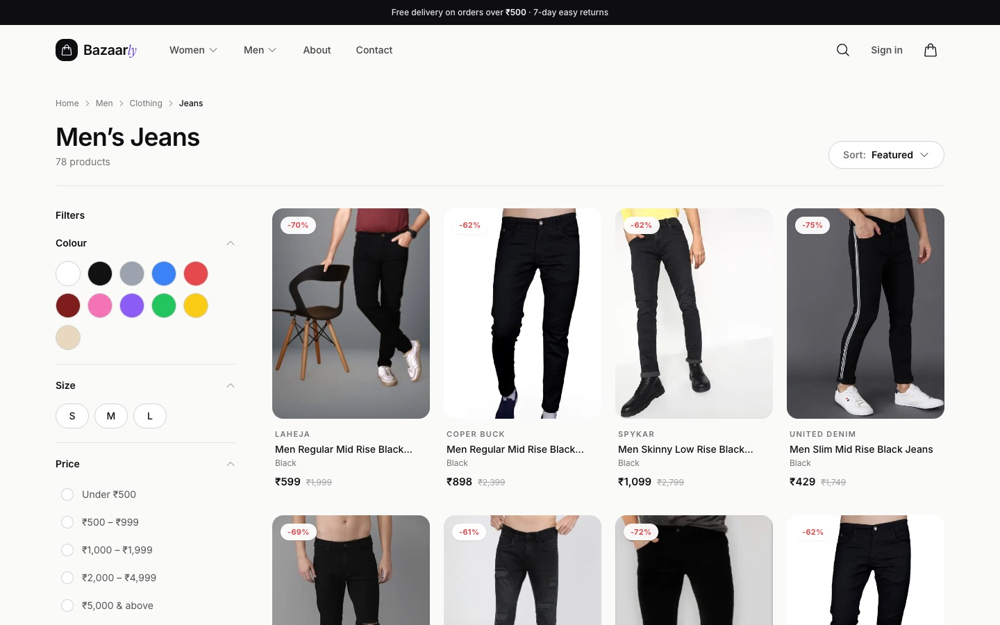
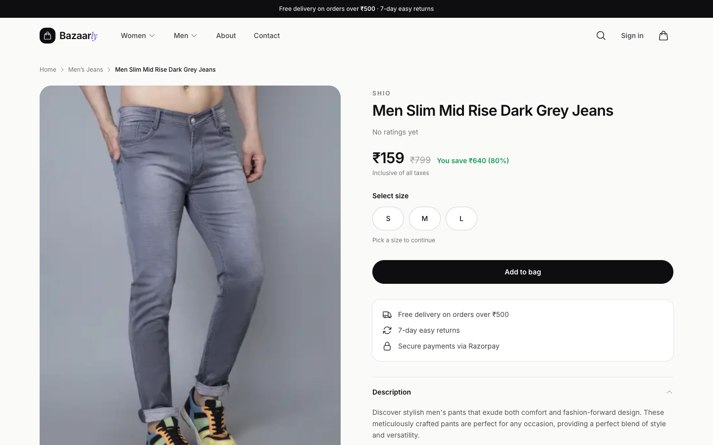
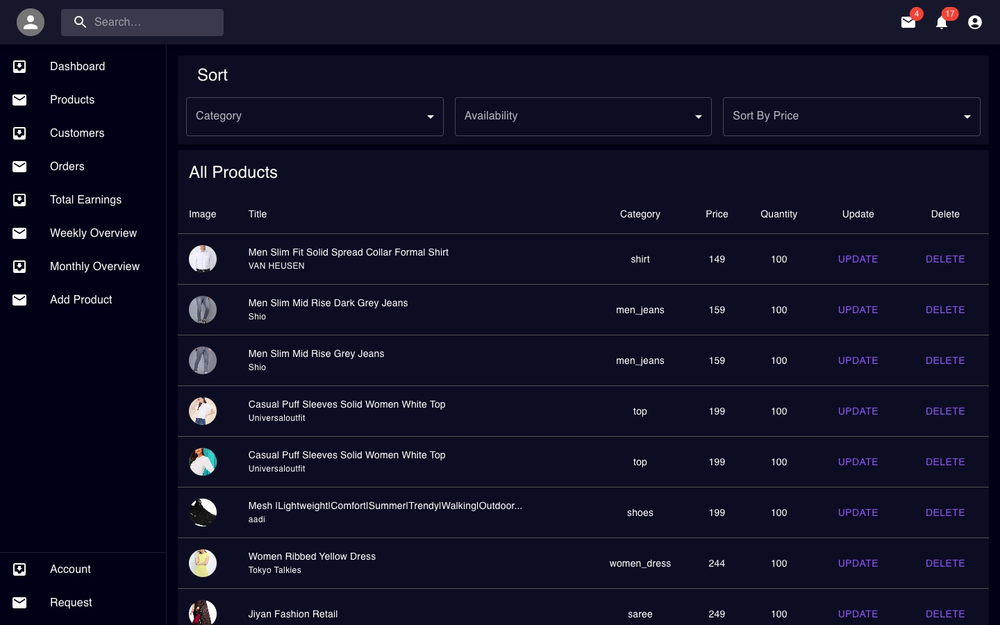
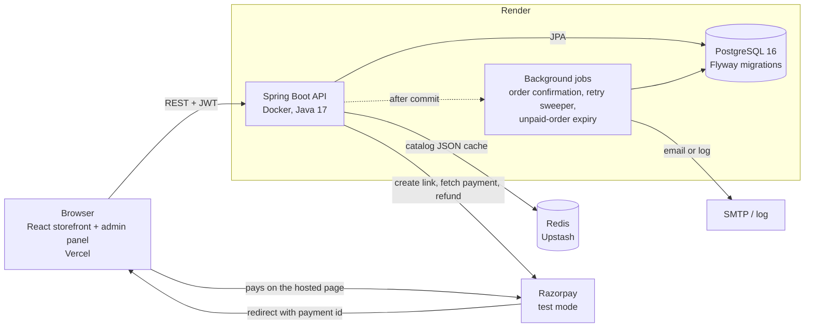

# Bazaarly API

[](https://github.com/themukuldharashivkar/ecommerce-server/actions/workflows/ci.yml)

Bazaarly is a full-stack clothing store. This repository is its REST API, built with Spring Boot 3 and Java 17, and the React storefront lives in [ecommerce-frontend](https://github.com/themukuldharashivkar/ecommerce-frontend). Shoppers browse and search a 499-product catalog, keep a cart and pay through Razorpay (test mode), and an admin panel manages products and orders. The API runs on PostgreSQL with Flyway migrations and caches the catalog in Redis. Placing an order reserves stock without overselling, which is proven by concurrency tests and a load test; payments are verified with Razorpay and never trusted from the browser. Order confirmations go through a transactional outbox and an async job. There are 313 automated tests, most against real PostgreSQL and Redis in Docker.

## Live demo

| | |
|---|---|
| Storefront | _added when the storefront goes to production (see [go to production](docs/DEPLOYMENT.md#6-after-the-live-checks-pass-go-to-production))_ |
| API | https://bazaarly-api.onrender.com ([health](https://bazaarly-api.onrender.com/actuator/health)) |
| API docs (Swagger UI) | https://bazaarly-api.onrender.com/swagger-ui.html |

| Demo account | Email | Password | Can do |
|---|---|---|---|
| Shopper | `demo@bazaarly.app` | `password@123` | browse, cart, checkout, pay |
| Admin (read-only) | `demo-admin@bazaarly.app` | `admin@123` | open the whole admin panel; every change is refused (403) |

Payments are in **Razorpay test mode** and no real money moves. At checkout, choose **Netbanking**, pick any bank and click **Success** on Razorpay's test page. You can also pay with the test card `5267 3181 8797 5449`, any future expiry and any CVV.

The API runs on Render's free plan, which sleeps after 15 minutes without traffic. The first request after that waits for the app to start: about 2 minutes in a rehearsal with the same CPU and memory limits ([details](docs/DEPLOYMENT.md#free-tier-limits-to-know)).

## Screenshots

| Catalog with filters | Product page | Admin panel (products and stock) |
|---|---|---|
|  |  |  |

Taken from the live API with the read-only demo admin.

## Architecture



**An order, end to end:**
1. `POST /api/orders/` creates the order and **reserves stock** in the same transaction. Each size is decremented by a conditional `UPDATE ... WHERE quantity >= n`, so two shoppers can't buy the last unit; the loser gets **409** with how many are left. Rows are locked in a fixed order, so concurrent orders can't deadlock ([docs/CONCURRENCY.md](docs/CONCURRENCY.md)).
2. `POST /api/payments/{orderId}` creates a Razorpay payment link that expires with the reservation, or returns the order's existing link if it can still be paid.
3. The shopper pays on Razorpay's page and is sent back to the storefront with a payment id.
4. `GET /api/payments?payment_id=...&order_id=...` asks Razorpay for that payment. The order is marked paid only if the payment was captured, for the full amount, through this order's own link. The order row is locked first, so a repeat or concurrent confirmation does nothing. In the same transaction the cart lines are removed and a confirmation row is written to the outbox.
5. After the commit an async job sends the confirmation, and a scheduled sweeper retries failed sends. Orders still unpaid when the reservation ends (60 minutes) are cancelled and their stock is released. A payment that arrives after that is refunded automatically.

## Tech stack

| Area | Used |
|---|---|
| Language and framework | Java 17, Spring Boot 3.0 (Web, Data JPA, Security, Validation, Cache, Actuator, Mail) |
| Data | PostgreSQL 16, Hibernate 6, Flyway (7 migrations), `pg_trgm` trigram indexes for search |
| Cache | Redis (Spring Cache; Upstash in production) |
| Auth | Stateless JWT (jjwt), BCrypt, role-based access, Bucket4j rate limits on sign-in and sign-up |
| Payments | Razorpay Java SDK: Payment Links, payment lookup, refunds |
| API docs | springdoc-openapi (Swagger UI) |
| Tests | JUnit 5, Mockito, Spring Boot Test, Testcontainers (PostgreSQL, Redis), JaCoCo |
| Delivery | Docker (multi-stage, non-root), Docker Compose, GitHub Actions, Render, Vercel |
| Frontend ([separate repo](https://github.com/themukuldharashivkar/ecommerce-frontend)) | React 18, Redux, React Router, MUI and Tailwind CSS, axios |

## Key engineering decisions

**PostgreSQL with Flyway instead of `ddl-auto`.** The schema is defined by versioned SQL migrations (`src/main/resources/db/migration`), and Hibernate only checks it at startup (`ddl-auto=validate`). The tests build their database from the same migrations, so a migration that doesn't match the entities fails CI rather than production.
- V2 adds the indexes: a composite `(category_id, discounted_price)` for the catalog, trigram GIN indexes for search, and every foreign key (PostgreSQL doesn't index foreign keys on its own).
- Later migrations add the notification outbox, a unique size per product, refunds and the read-only admin role.

**Stock under concurrency.** Stock is taken with one conditional `UPDATE` per row, which PostgreSQL re-checks on the current row even at the default `READ COMMITTED` level. `CHECK (quantity >= 0)` makes the database refuse negative stock. Rows are locked in one global order (products by id; a product's sizes before the product row), so orders never deadlock.
- Releasing stock (cancel, expiry, delete) and confirming a payment all lock the order row and re-check its status, so stock comes back exactly once.
- Concurrency tests found and fixed real bugs: Hibernate returning a stale order under the row lock (stock given back three times, an expired order marked paid), an unlocked delete, and two kinds of deadlock.
- [docs/CONCURRENCY.md](docs/CONCURRENCY.md) covers the race, the fix, the alternatives (pessimistic and optimistic locking) and the measurements.

**What the cache stores, and when it is cleared.** Only the public catalog is cached: product pages, catalog pages and search results. The value is the finished JSON response, not entities, so a hit is byte-for-byte identical to a miss and Hibernate's lazy collections never go into Redis.
- Changing a product, review or rating clears the affected entries straight away. So does a stock change, but only after its transaction commits, so a rolled-back order can't leave stale stock in the cache.
- TTLs are only a safety net: 10 minutes for catalog pages, 30 minutes for a product.
- If Redis is down, requests go to the database. The cache makes the site faster but never takes it down.
- Carts, orders and anything else per-user are never cached.

**Auth.** Sign-in returns a JWT signed with HMAC-SHA256. It is valid for 24 hours and carries the user's role. The API keeps no sessions.
- There are three roles: `ROLE_USER`, `ROLE_ADMIN`, and `ROLE_ADMIN_VIEWER` (can read admin endpoints, gets 403 on writes).
- Admin and demo accounts are created at startup from environment variables; there is no way to sign up as an admin.
- Users can only read their own orders and addresses; other users' ids return 404.
- Sign-in and sign-up are rate-limited per client IP (10 per minute and 5 per 10 minutes).
- Errors always come back as one JSON shape: 401 and 403 from Spring Security, 400 for validation errors, and so on.

**Payment confirmation and idempotency.** The browser only passes the payment id along: the API looks up the payment with Razorpay itself and checks that it was captured, for the order's full amount, through that order's own payment link.
- Confirmation locks the order row (`SELECT ... FOR UPDATE`). A repeat confirmation, a double click or two tabs therefore mark the order paid once and write one outbox row, so the shopper gets one email.
- Each order keeps one payable link, so refreshing the payment page doesn't create a second one.
- Cancelling a paid order refunds it. Refunds are idempotent: before refunding, the API checks Razorpay for an existing refund.

**Async confirmation email through an outbox.** The confirmation is a database row written in the payment transaction. The email is sent by an `@Async` listener that runs only after the commit, so the payment response never waits for SMTP.
- A scheduled sweeper retries failed sends with backoff, and frees sends that got stuck because the app restarted mid-send.
- A row can be claimed for sending by only one process, so retries and concurrency still send one email.
- In this deployment there is no SMTP server, so confirmations are written to the log.

## Performance

All numbers come from real runs; [docs/PERFORMANCE.md](docs/PERFORMANCE.md) has the method, environment and limits for each.

| Change | Measured on | Before → after |
|---|---|---|
| Search rewritten to use trigram indexes | 100,299 products, PostgreSQL `EXPLAIN ANALYZE` | `jeans` 76.4 → 10.7 ms, `silk` 94.4 → 1.8 ms |
| Composite index for catalog filters | same | 9.5–22.0 ms → 3.5–13.0 ms (1.7–2.7×) |
| Filtering and paging moved from Java into SQL | 100,299 products, HTTP p50 | 68.1 → 6.3 ms (no filters), 756.8 → 23.0 ms (colour + size + price + discount + stock) |
| Redis cache for catalog pages | 499 products, HTTP, concurrency 10 | p95 20.4 → 0.8 ms, 639 → 16,424 req/s (cache hits) |
| 500 shoppers ordering one product with 200 in stock | 50 in flight, 3 runs | exactly 200 placed and 300 refused (409), stock 0, no errors; placed p95 171–205 ms, 475–545 req/s |

The benchmarks ran on a laptop over loopback, so read them as before/after comparisons, not production latencies. On the live deployment a warm catalog request takes about 250–265 ms (p50, measured from India), mostly TLS and Render's proxy.

## Testing

```bash
./mvnw verify      # needs Docker running
```

| Suite | Tests | What |
|---|---|---|
| Unit (JUnit 5 + Mockito), `src/test/java/com/bazaarly/unit` | 76 | services: cart, orders, stock, payment creation and confirmation, catalog filters, JWT, roles, admin bootstrap |
| Integration (Spring Boot + Testcontainers), `src/test/java/com/bazaarly/integration` | 237 | the HTTP API end to end on PostgreSQL and Redis, including 6 concurrency tests run 20 times each (120) |
| **Total** | **313** | 0 failures (`./mvnw verify`, 19 Nov 2026) |

JaCoCo line coverage: service layer (`service` and `payment` packages) **86.3%**, `service` alone 94.7%, whole codebase 80.9% (63.8% of branches). `payment` is lower on purpose: `RazorpayPaymentGateway`, the thin wrapper around the Razorpay SDK, is not called in tests.

- Integration tests run on **real PostgreSQL 16 and Redis** (Testcontainers), with the schema built by the real Flyway migrations, not H2.
- Razorpay is never called: tests mock the `PaymentGateway` interface, and the mocks follow Razorpay's real behaviour. For example, a payment link has no order id until it is paid; that is how the live test payment found a bug.
- They cover: authentication and JWT edge cases (expired, forged, malformed), role checks on every admin endpoint, the full cart → order → payment flow, concurrency (50 buyers for 10 units, opposite-order and multi-size orders without deadlocks, cancel/expire/delete releasing stock once, a payment racing the expiry), each repeated 20 times, refunds, cache hits and evictions, the async job under retries and concurrency, validation, rate limits and error responses.
- To check that the tests catch real bugs, bugs were planted on purpose: removing the stock guard, the idempotency checks, the role rule or cache eviction each made at least one test fail ([list](docs/CURRENT_STATE.md#tests)).

Coverage report: `target/site/jacoco/index.html` after `./mvnw verify`. One class: `./mvnw test -Dtest=CheckoutFlowIntegrationTest`.

## Run locally

### With Docker (one command)

Needs Docker. From this folder:

```bash
docker compose up --build
```

| | URL |
|---|---|
| API | http://localhost:5454 |
| Swagger UI | http://localhost:5454/swagger-ui.html |
| Health | http://localhost:5454/actuator/health |
| Mail inbox (order confirmations) | http://localhost:8025 |

This starts the API with PostgreSQL 16, Redis and Mailpit. On first start Flyway creates the schema and the 499 demo products are loaded. Data lives in the `bazaarly_postgres-data` volume, so it survives restarts (`docker compose down -v` removes it).

To run the React storefront too (http://localhost:3000), clone `ecommerce-frontend` next to this folder and add the profile:

```bash
docker compose --profile storefront up --build
```

Without a `.env` file the stack uses **local-only** defaults:
- admin login `admin@bazaarly.local` / `admin-local-only-123`
- a fixed JWT secret
- placeholder Razorpay keys, so creating a payment link fails until you set `RAZORPAY_KEY_ID`/`RAZORPAY_KEY_SECRET` (free test keys from the Razorpay dashboard)

Copy `.env.example` to `.env` to override any of them. Never deploy with the defaults.

### Without Docker

Needs Java 17+ and PostgreSQL 14+.

```bash
cp .env.example .env     # set DB_PASSWORD, ADMIN_EMAIL/ADMIN_PASSWORD, Razorpay test keys
./mvnw spring-boot:run   # http://localhost:5454, dev profile (in-memory cache, emails logged)
```

For the storefront, see the [frontend README](https://github.com/themukuldharashivkar/ecommerce-frontend#run-locally).

## API overview

The full, interactive reference is in Swagger UI (`/swagger-ui.html`). The main endpoints:

| Method and path | Who | What |
|---|---|---|
| `POST /auth/signup`, `POST /auth/signin` | anyone | create an account, sign in (returns a JWT) |
| `GET /api/products` | anyone | catalog: category, colour, size, price, discount, stock filters; sort; paging |
| `GET /api/products/search?q=` | anyone | search name, brand, description and category (paged, total in `X-Total-Count`) |
| `GET /api/products/id/{id}` | anyone | product details |
| `GET /api/cart/`, `PUT /api/cart/add` | shopper | view the cart, add an item |
| `PUT`/`DELETE /api/cart_items/{id}` | shopper | change quantity, remove |
| `POST /api/orders/` | shopper | place an order from the cart (reserves stock; 409 if an item ran out) |
| `GET /api/orders/user`, `GET /api/orders/{id}` | shopper | own orders |
| `POST /api/payments/{orderId}` | shopper | get the Razorpay payment link |
| `GET /api/payments?payment_id=&order_id=` | shopper | confirm a payment after Razorpay's redirect |
| `POST /api/reviews/create`, `POST /api/ratings/create` | shopper | review and rate a product |
| `GET /api/admin/orders/`, `PUT /api/admin/orders/{id}/confirmed\|ship\|deliver\|cancel` | admin | manage orders (cancelling a paid order refunds it) |
| `GET /api/admin/products/all`, `POST /api/admin/products/`, `PUT .../{id}/update`, `DELETE .../{id}/delete` | admin | manage products and stock |
| `GET /actuator/health` | anyone | health check |

## Deployment and CI

- **CI** (GitHub Actions) runs on every push and pull request. It scans the whole git history for secrets (gitleaks, [docs/SECURITY.md](docs/SECURITY.md)), runs `./mvnw verify` with all tests, and then builds the Docker image. On `main` the image is pushed to GitHub Container Registry.
- **Hosting:** the API runs on Render from [`render.yaml`](render.yaml) (Docker, PostgreSQL 16), Redis on Upstash and the storefront on Vercel. Setup, free-tier limits and the live checks are in [docs/DEPLOYMENT.md](docs/DEPLOYMENT.md).

## What I would improve next

- **Payment webhooks.** Confirmation depends on the shopper coming back to the storefront. If they close the tab after paying, the order is never marked paid: it is cancelled after 60 minutes, and the payment has to be refunded by hand. A Razorpay webhook would confirm payments server-side.
- **Cold starts.** The free Render instance (0.1 CPU) takes about 2 minutes to start after sleeping. A paid instance, or a smaller runtime (Spring AOT or GraalVM native image), would fix it.
- **Admin dashboard and customers page.** The dashboard's charts and totals (sales, revenue, customers) and the customers list are static sample data from the original UI template. Only the products and orders pages use the API. They would need new endpoints: sales and revenue totals, and a customer list for admins.
- **Frontend tests.** The storefront has no automated tests yet; CI only lints and builds it. Playwright tests for the checkout would be next.
- **Search.** Trigram `LIKE` search works at 100k products but doesn't rank results. PostgreSQL full-text search with ranking, or a search service, would be better for a real catalog.
- **Observability.** Metrics (Micrometer and Prometheus) and structured logs with a request id, instead of plain log lines.
- **Product images** are external URLs from the original dataset. Real uploads would need object storage (S3 or similar) and a CDN.
- **Legacy naming.** Some names from the original code are still there (the `modal` package, the `GlobleException` class, `/api/admin/products/creates`). Renaming them would change the API, so it waits for a versioned API.

## More docs

- [docs/CONCURRENCY.md](docs/CONCURRENCY.md): stock under concurrency: the race, the fix, the bugs found, alternatives
- [docs/PERFORMANCE.md](docs/PERFORMANCE.md): every measurement, with method and limits
- [docs/DEPLOYMENT.md](docs/DEPLOYMENT.md): Render, Upstash and Vercel setup, and the live verification
- [docs/CURRENT_STATE.md](docs/CURRENT_STATE.md): configuration, profiles, fixed and known issues
- [docs/SECURITY.md](docs/SECURITY.md): where secrets live, the CI secret scan, and secrets in old commits that must be rotated
