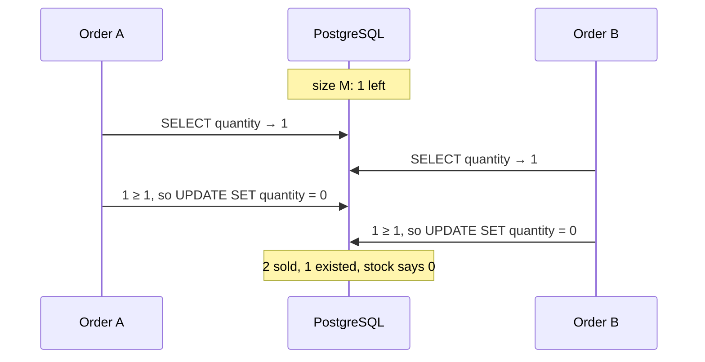
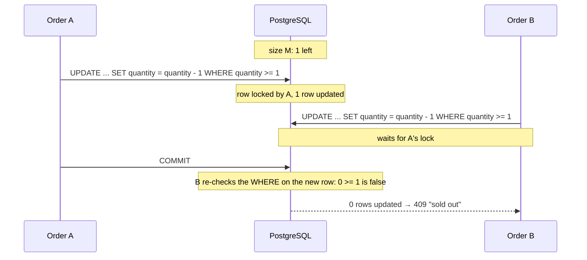

# Stock under concurrency

Two shoppers buying the last item at the same moment must not both succeed. This document covers:
- how stock is handled
- which races existed, and how each was reproduced
- how they were fixed and why the fix is safe
- the alternatives
- the measurements

Everything here comes from runs on this code.

## How stock is stored and changed

| Where | What |
|---|---|
| `product.quantity` | total stock of a product |
| `product_sizes.quantity` | stock per size; one row per `(product_id, lower(name))` (unique index, V4) |
| `V7__stock_constraints.sql` | `CHECK (quantity >= 0)` on both columns: the database refuses negative stock |

| When | What happens to stock | Code |
|---|---|---|
| Add to cart | checked against current stock, **not** reserved | `StockService.checkAvailable` |
| Place order (`POST /api/orders/`) | reserved: taken out of stock in the same transaction that creates the order | `OrderServiceImplementation.createOrder` → `StockService.reserve` |
| Payment confirmed | nothing (already reserved); the order becomes `PLACED` | `PaymentService.markPaid` |
| Order cancelled (admin), expired unpaid, or deleted | released: given back | `cancelOrder`, `expireIfUnpaid`, `deleteOrder` → `StockService.release` |
| Admin edits a product | only the fields sent are written (`@DynamicUpdate`), so a stale edit doesn't overwrite reserved stock | `ProductServiceImplementation.updateProduct` |

An unpaid order is in status `PENDING` (the plan calls it `PENDING_PAYMENT`). It holds its stock for **60 minutes**, the life of its Razorpay payment link. `OrderExpiryJob` (`@Scheduled`, every minute) cancels it 5 minutes after that and releases the stock.

Three decisions (agreed before implementing):
- **60 minutes, not 15.** Razorpay refuses payment links that expire less than 15 minutes ahead, so a 15-minute reservation would make every link fail.
- **A failed payment attempt doesn't release the stock.** A payment link can be retried after a failed attempt. Releasing on the first failure would let the retry succeed with no stock behind it. The stock comes back when the order is cancelled or expires.
- **Status changes use a row lock** (`SELECT ... FOR UPDATE`, then a status check), not the plan's example of a guarded `UPDATE ... WHERE status = 'PENDING'`. Both are safe; see [Alternatives](#alternatives).

## The race, in plain words

The classic bug is *read, check, write*:



Both orders read the same value before either wrote, so both pass the check. The second write overwrites the first, a **lost update**.

The fix makes the check and the write **one statement**, which the database runs on the current row:



## The fix

`StockService.reserve` and `release`:

1. **One conditional update per row:**
   - `UPDATE product_sizes SET quantity = quantity - ? WHERE product_id = ? AND lower(name) = ? AND quantity >= ?`, then
   - `UPDATE product SET quantity = quantity - ? WHERE id = ? AND quantity >= ?`.

   0 rows updated means not enough stock. The order is refused with **409 Conflict**:
   ```json
   {"error":"Only 2 left of Men Slim Mid Rise Dark Grey Jeans in size M","productId":448,"size":"M","available":2,"details":"uri=/api/orders/","timestamp":"..."}
   ```
2. **One transaction.** `createOrder` is `@Transactional(rollbackFor = Exception.class)` and `reserve` requires a transaction (`Propagation.MANDATORY`). If any line can't be reserved, the whole order rolls back: no order, no order items, no address, and no stock taken from the earlier lines. A partial order can't exist.
3. **One global lock order, so concurrent orders can't deadlock.** Each `UPDATE` locks its row until commit, and orders lock in this order:
   - products by ascending id
   - within a product, all its size rows first (sorted by size), then the product row once, for that product's total

   See the second deadlock below for why the product row must come after **all** its sizes.
4. **The database as the last line of defence.** `CHECK (quantity >= 0)` (V7) refuses negative stock even if a future code path forgets the `WHERE`.
5. **Release happens once.** Cancel, expiry, delete and payment confirmation all lock the order row first, then re-check its status while holding the lock:
   - Only a transition out of `PENDING`, `PLACED` or `CONFIRMED` releases stock.
   - A second cancel, or an expiry after a cancel, sees `CANCELLED` and does nothing.
   - A payment that finds the order `CANCELLED` refunds itself (see [Late payments](#late-payments)).

### Why this is safe under READ COMMITTED

PostgreSQL's default isolation level is `READ COMMITTED`. A plain `SELECT` sees data committed before the statement started, which is why read-check-write is unsafe: the value can change between the read and the write.

An `UPDATE` works differently:
- If the row it wants is locked by another transaction's update, it **waits** for that transaction to finish.
- If that transaction committed, it **re-evaluates its `WHERE` clause on the newest version of the row** before updating.

So `quantity >= n` is always checked against committed, current stock, and only by one transaction at a time per row. No stronger isolation level (`REPEATABLE READ` or `SERIALIZABLE`, which would need retry logic) is needed.

The same applies to the order-row lock (`SELECT ... FOR UPDATE`): the second transaction waits, then reads the current row.

The cart check at add-to-cart is a convenience for the shopper. It isn't relied on: stock can change before the order is placed, and only the conditional `UPDATE` at order time decides.

## Bugs found (each reproduced by a test before it was fixed)

The tests are in `StockConcurrencyIntegrationTest`. Each releases its requests together through a `CountDownLatch` start gate on a thread pool, against Testcontainers PostgreSQL 16, and runs 20 times (`@RepeatedTest(20)`). They were committed failing on their own (commit `37898e3`), then fixed.

| Bug | How it showed up (before the fix) | Cause | Fix |
|---|---|---|---|
| **Stale order under the row lock** | Cancel + expiry at the same time: stock given back up to **3 times** (20/20 runs). Payment + expiry: an expired order marked **PLACED with its stock released** (a paid order with nothing reserved). | With `open-in-view` (Spring's default), a web request keeps one Hibernate session. The services load the order before locking it. `findByIdForUpdate` did take the row lock, but Hibernate returned the instance it had already loaded, with the old status. | `findByIdForUpdate` now locks with `SELECT id ... FOR UPDATE` and then **refreshes** the order from the locked row (`OrderRepositoryCustomImpl`). All callers are unchanged. |
| **Unlocked delete** | Delete + expiry at the same time: stock given back twice (20/20 runs), sometimes a deadlock. | `deleteOrder` read the order without a lock. | It locks the order like cancel and expiry do. |
| **Deadlock: products in opposite order** | Two products, half the buyers add A then B and half B then A: requests failed with 500 `deadlock detected` (20/20 runs). | Rows were locked in cart order. | Lock products in ascending id order. |
| **Deadlock: two sizes of one product** | Found while writing this document. Buyers of M+L, L only and M only: 500 `deadlock detected` (20/20 runs, 152 deadlock log lines), even with products sorted. | Order 1 locked size M, then the product row, then waited for L. Order 2 held L and waited for the product row. | For each product, lock all size rows first, then the product row once. |
| **Wrong status for out-of-stock** | 400 with only a message. | — | 409 with `productId`, `size`, `available`. |

### Reproducing the original oversell

Today's code already reserved stock with a conditional `UPDATE` (added in commit `42a941a`), so the 50-buyer test couldn't fail on it. It was reproduced two other ways, with a probe that measures without asserting: 50 buyers, 10 in stock (size M), 20 runs.

| Code | Orders accepted | Other responses | Stock at the end |
|---|---|---|---|
| Commit `407e94c` (before stock was reserved at all) | **19–42** (for 10 in stock) | 8–31 × **500** (`deadlock detected`, 696 log lines) | product total unchanged (10); the single size row had **multiplied into 10–44 rows** (an old Hibernate bug, fixed in V4) |
| Read-check-write (local branch `experiment/naive-stock-check`, never merged) | 10 | 40 × 400 | product 0, but **size M showed 6–9 left** after selling all 10: lost updates |
| Current code | **10** | **40 × 409** | **0 and 0**, in every run |

The read-check-write version didn't oversell the product total, only because the size row's lock happened to serialise the product reads. Its size counter was still wrong in every run (6–9 left after the size had sold out), so a later buyer could have been sold a size that no longer existed.

### Late payments

A payment can be confirmed while the order expires. The test runs both at once, 20 times, and accepts only two outcomes:
- **The payment wins:** the order is `PLACED`, payment `COMPLETED`, stock still reserved (9 of 10 left), no refund.
- **The expiry wins:** the order is `CANCELLED`, the stock comes back once (10 of 10), and the payment is **refunded automatically** and recorded (`REFUNDED`). The shopper sees "This order expired before the payment completed. Your payment has been refunded."

Before the stale-order fix there was a third outcome: `PLACED` with the stock released. That fails the test, and it did, 20 out of 20 times.

## Tests

| Test (`@RepeatedTest(20)` each) | Checks |
|---|---|
| `fiftyConcurrentBuyersForTenItemsGiveExactlyTenOrders` | exactly 10 × 200 and 40 × 409 (each naming the product, size and 0 left); product and size stock 0; 10 orders |
| `ordersWithTheSameProductsInOppositeOrderDoNotDeadlock` | 20 two-product orders, opposite cart order: all succeed, stock exact |
| `ordersForSeveralSizesOfOneProductDoNotDeadlock` | 30 orders mixing M+L, L, M: all succeed, stock exact |
| `cancelAndExpireAtTheSameTimeReleaseTheStockOnce` | two cancels and an expiry at once, then a cancel and an expiry again: stock restored exactly once |
| `deleteAndExpireAtTheSameTimeReleaseTheStockOnce` | stock restored exactly once |
| `paymentArrivingWhileTheOrderExpiresEitherPlacesItOrRefundsIt` | one of the two outcomes above, never a mix |

The whole class (120 runs) passed in three separate executions, 360 runs in total, with no `deadlock detected` in the logs. The existing tests still pass: 313 in all (`./mvnw verify`).

## Frontend

On a 409 at checkout, the storefront:
- shows the API's message, for example *"Only 2 left of … in size M. Update your bag and try again."*
- stays on the address step
- reloads the bag

Before this, a refused order failed silently: the order action read `data.message`, but the API sends `data.error`, and the address step never showed order errors. This was checked in a browser with a simulated 409: the message appeared, the bag was fetched again and there were no page errors.

## Cache

Stock is never read from the cache to decide anything; the conditional `UPDATE` always goes to PostgreSQL. Product pages and catalog pages are cached (Redis) and include stock.
- `reserve` and `release` evict the affected product pages and the catalog **after the transaction commits**, so a rolled-back order can't leave wrong stock in the cache.
- Between a commit and the eviction, or if eviction fails (it is logged), a product page can show stock that is slightly out of date, for at most its TTL (30 minutes for a product, 10 for catalog pages).
- That only affects what is displayed. An order for stock that is gone gets a 409.

## Alternatives

| Approach | How | Contention behaviour | Retries | Complexity | Verdict |
|---|---|---|---|---|---|
| **Atomic conditional update** (chosen) | `UPDATE ... SET q = q - n WHERE q >= n`, check rows updated | concurrent orders queue on the row for the length of one short transaction; refusals are instant once stock is 0 | none | lowest: one statement per row | chosen: simplest, correct under READ COMMITTED, no retry loop |
| Pessimistic lock | `SELECT ... FOR UPDATE` on the product, check in Java, then `UPDATE` | same queueing, but the lock is taken before the check, so it is held a little longer | none | one more query per row; the order of locks still matters (deadlocks) | used for **order status** changes, where several fields are read and changed together; for a single counter the conditional update does the same with less |
| Optimistic lock | `@Version` column; write fails if someone else wrote first; retry | no waiting, but on a hot product almost every concurrent write conflicts, so many retries; can starve under load | yes, bounded with backoff | a version column, retry logic, and limits | poor fit for a hot counter; good for rarely contended data (an admin editing a product) |
| Guarded status transition | `UPDATE orders SET status = 'CANCELLED' WHERE id = ? AND status = 'PENDING'`, release only if 1 row | same as the row lock | none | moves the rules into SQL | equivalent to the row lock used here; the row lock was kept because it was already in place and tested |
| `SERIALIZABLE` isolation | the database detects conflicts | conflicting transactions abort | yes, needed | retry logic for every transaction | unnecessary here |

The optional throughput comparison with an alternative wasn't done. No numbers are claimed for it.

## Load test (hot product)

500 different shoppers order the same product, 50 requests in flight, with 200 units in stock. Three runs on the final code; [PERFORMANCE.md](PERFORMANCE.md#4-orders-for-one-hot-product-revised-plan-step-3-measured-2026-11-19) has the full conditions.

| | Run 1 | Run 2 | Run 3 |
|---|---|---|---|
| 200 (order placed) | 200 | 200 | 200 |
| 409 (out of stock) | 300 | 300 | 300 |
| other | 0 | 0 | 0 |
| Final stock (product / size) | 0 / 0 | 0 / 0 | 0 / 0 |
| p50 / p95, placed orders | 156.5 / 204.9 ms | 146.3 / 192.0 ms | 128.8 / 171.2 ms |
| p50 / p95, refusals | 60.7 / 148.4 ms | 75.7 / 129.3 ms | 60.3 / 113.4 ms |
| Throughput | 475 req/s | 477 req/s | 545 req/s |

## Known limits

- **A shopper can hold stock by placing orders and not paying.** Each unpaid order reserves stock for 60 minutes, and nothing limits how many unpaid orders one account can have. A cap on open unpaid orders per account would close this.
- **The cart check is advisory:** an item can sell out between "add to bag" and "place order". The 409 at checkout handles that.
- **Webhooks.** If the shopper closes the tab after paying, the payment is never confirmed: the order expires and the payment must be refunded by hand (see the README's "What I would improve next").
